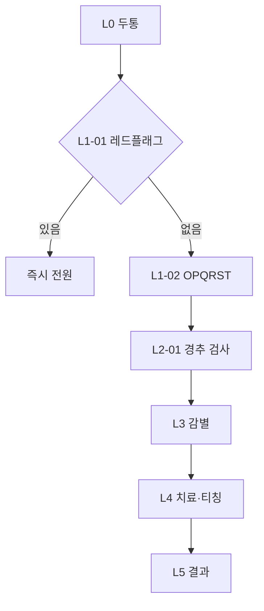

# 프로토콜 노드 스키마 v0.1

적용 범위: `_임상/프로토콜/**` · `_임상/스킬/**` · `_임상/케이스/**`
검사 도구: `workspace\clin-protocol\build_tree.py --check`

## 1. 파일 배치

| 파일 | 내용 |
| :--- | :--- |
| `00_트리.md` | mermaid 전체 트리 + 노드 표(상태·내숙련도·사용횟수) |
| `10_L1_문진.md` | ask 노드 |
| `20_L2_검사.md` | test 노드 |
| `30_L3_감별.md` | dx 노드 |
| `40_L4_치료.md` | treat 노드 |
| `50_L4_티칭.md` | teach 노드 |
| `60_L5_결과.md` | outcome 노드 |
| `90_개정이력.md` | 개정 사유·날짜·근거 (삭제 금지) |

## 2. 노드 frontmatter

```yaml
id: HA-L1-03                 # 필수 · <증상코드>-L<층>-<번호>
유형: ask                    # 필수 · ask|test|dx|treat|teach|outcome|skill
제목: 야간 각성 통증 확인     # 필수
상위: HA-L1-02               # 루트는 생략
조건: "밤에 두통 때문에 깨는가"   # 이 노드로 오는 판정 조건
다음: [HA-L2-01]             # 조건별로 나눠 쓴다: {예: [...], 아니오: [...]}
레드플래그: false             # ask는 필수
질환링크: ["[[긴장성 두통]]"]  # dx는 필수
근거: "교과서/가이드라인/PMID"  # 정본이면 필수
신뢰도: 상                    # 상|중|하
상태: 초안                    # 초안|검토|정본
내숙련도: 0                   # 0~5 (treat·skill 필수)
사용: {case: 0, last: null}
개정: 2026-11-18
```

## 3. 유형별 필수 필드

| 유형 | 반드시 있어야 하는 것 |
| :--- | :--- |
| **ask** | 질문 1개 · **왜 묻는가 1줄** · 예/아니오 다음 노드 · 레드플래그 여부 |
| **test** | 검사명 · **무엇을 배제하는가** · 민감도·특이도·LR+ · 소요시간 · 대안 검사 |
| **dx** | 후보 3~5 · 확률을 올리는 소견 · 내리는 소견 · **놓치면 위험한 감별** · 질환 노트 링크 |
| **treat** | 술기 세트(침·약침·한약·추나·부항) · 자침점·용량 · 빈도 · 기간 · 금기 · 부작용 · **재평가 시점** · **전원 기준** |
| **teach** | 환자 설명 **3문장**(중학생 수준) · 생활 지도 · 흔한 오해 · 하지 말아야 할 것 |
| **outcome** | 측정 지표(NRS·ROM·빈도) · 측정 시점(즉시/1주/4주) · 좋음·나쁨 판정 기준 |
| **skill** | 술기명 · 적응 · 금기 · 필요 숙련도 · 소요시간 · 합병증 · 내 시행 횟수 |

## 4. 상태 전이

`초안 → 검토 → 정본` (건너뛰기 금지)

- **정본 승격 조건 3개 동시 충족**: ① 근거 기재 ② 전원 기준 기재 ③ 환자 설명 3문장
- **강등 사유**: 근거 갱신 · 반응률 40% 미만(n≥5) · 부작용 보고 · 가이드라인 변경
- 강등은 `90_개정이력.md`에 사유를 남긴 뒤 `상태: 검토`로 내린다.

## 5. 숙련도 정의 (내숙련도 0~5)

| 값 | 정의 | 트리 표시 |
| :--- | :--- | :--- |
| 0 | 해본 적 없음 — 관찰만 | ⛔ 이 노드에서 시행 금지, 위임/전원 |
| 1 | 관찰·보조 경험 | ⚠️ 지도 필요 |
| 2 | 지도하에 부분 시행 | ⚠️ 지도 필요 |
| 3 | 지도하에 끝까지 시행 | 🔶 가능 |
| 4 | 혼자 시행 가능 | ✅ |
| 5 | 남에게 가르칠 수 있음 | ✅ (교육 자료 작성 가능) |

## 6. 트리 허브 템플릿 (`00_트리.md`)

````markdown
# 두통 프로토콜 트리

> 참고 도구입니다. 최종 판단은 의사의 몫입니다.



| 노드 | 제목 | 상태 | 숙련도 | 사용 |
| :--- | :--- | :--- | :--- | :--- |
| HA-L1-01 | 레드플래그 | 정본 | — | 0 |
````

## 7. 케이스 로그 규격 (비식별)

```yaml
case: C-0001
날짜: 2026-11-20
증상: 두통
경로: [HA-L1-01, HA-L1-02, HA-L2-01, HA-L3-02, HA-L4-04]
최종진단: 경추성 두통
치료: "[[SK-003]] + [[SK-011]]"
결과: {NRS_전: 7, NRS_후: 3, 시점: 1주}
부작용: 없음
개정후보: "L1-02에 경추 가동범위 질문 추가"
```

- 이름·생년월일·연락처·주민번호·상세 주소 **기재 금지**. 연령대·성별까지만.

## 8. lint 규칙 (`--check`가 실패시키는 것)

1. `id` 중복 · 형식 위반
2. `상위`/`다음`이 존재하지 않는 노드 참조
3. 증상 폴더에 **레드플래그 ask 노드가 0개**
4. `dx`의 `질환링크` 파일이 실제로 없음
5. `상태: 정본`인데 `근거`가 비어 있음
6. 케이스 로그에 식별정보 패턴(전화번호·주민번호) 검출
7. `treat`에 `전원 기준` 누락

## 9. 개정 절차

1. 계기 기록(케이스·논문·가이드라인)
2. `90_개정이력.md`에 사유·근거·변경 전후 1줄
3. 노드 수정 → `상태: 검토` → 본인 확인 후 `정본`
